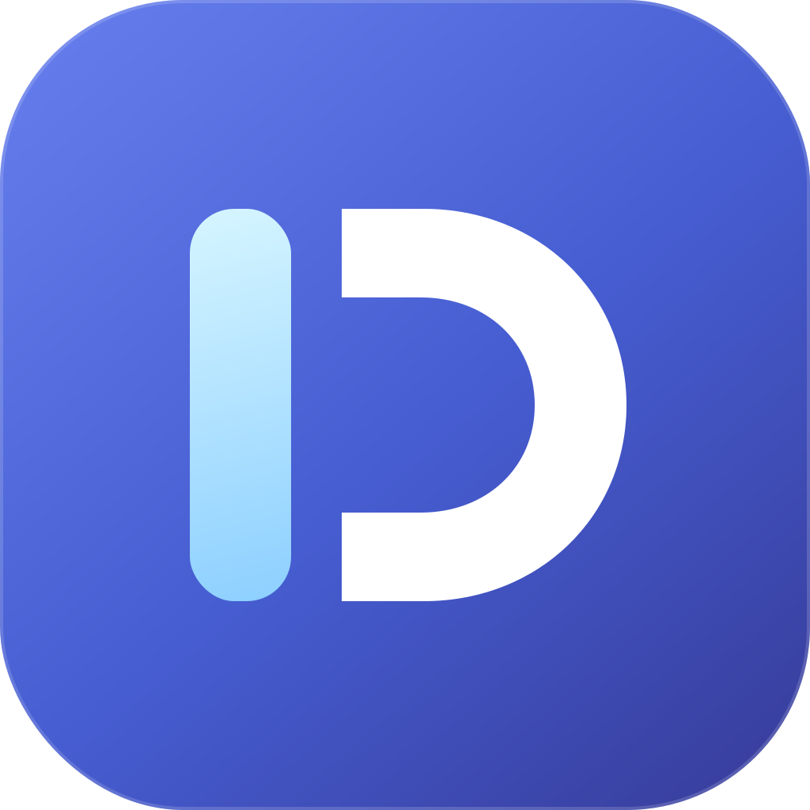
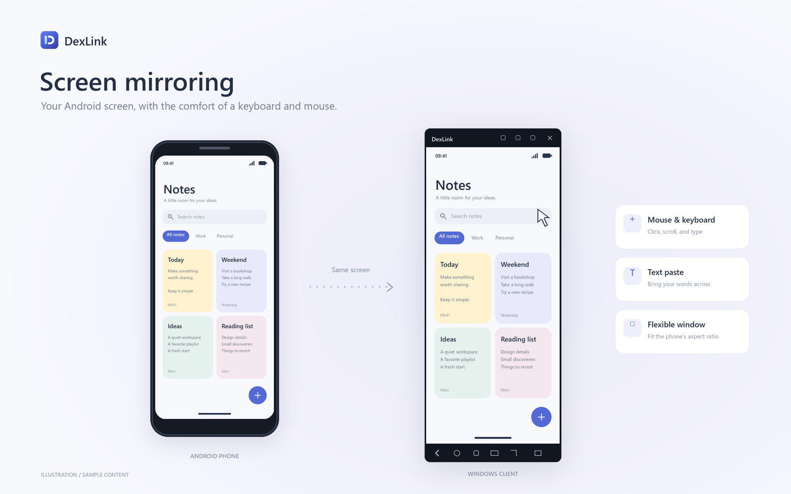
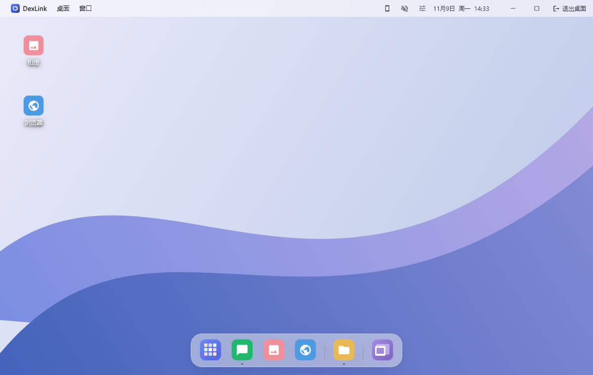
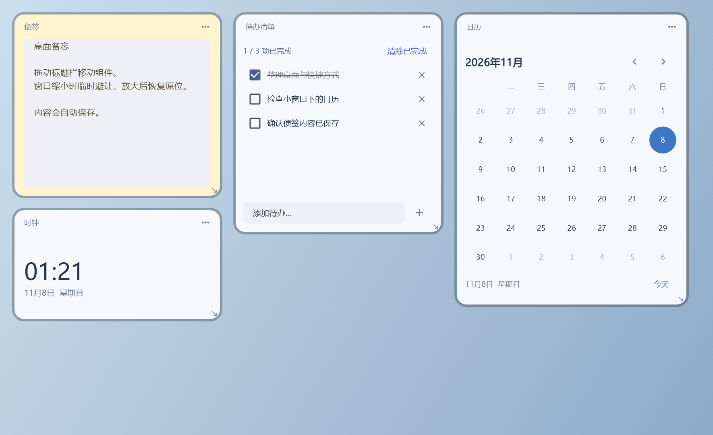

<p align="center">
  
</p>

# DexLink

**Mirror Android to Windows and control it with a keyboard and mouse, or open phone apps in an independent desktop workspace.**

[简体中文](README.md) · **English**

[](https://github.com/Fleve-MY/DexLink/releases)
[](LICENSE)
[](https://github.com/Fleve-MY/DexLink/actions/workflows/ci.yml)

DexLink offers **screen mirroring** and an **independent desktop**, powered by an Android app and a Windows client connected over a local network or USB tethering. Apps run on the phone while the PC displays their content and handles keyboard and mouse input.

The current version is **0.1.0 preview**. Physical-device validation has focused on Xiaomi 15 Pro / Android 17. Reports about other devices and Android versions are welcome.

## Two modes

| | Screen mirroring | Independent desktop |
| --- | --- | --- |
| Display | The phone's current screen, including actions performed on the phone | Phone apps run on independent virtual displays, with windows managed in the PC workspace |
| Best for | Using phone apps from the PC, presenting the phone screen, and typing | Working with multiple app windows, switching apps, and organizing a desktop |
| Controls | Mouse clicks, scrolling, keyboard input, and Android navigation | Move, resize, minimize, and restore windows, with a Dock and app search |
| Phone authorization | Basic mirroring uses Android screen-capture consent and accessibility for input; enhanced mirroring uses Shizuku | Start a Shizuku-compatible manager and authorize DexLink |

### Screen mirroring

View the phone's current screen in a resizable PC window that follows its aspect ratio. Use Back, Home, Recents, and text paste from the PC clipboard. This mode works well for using existing phone apps or presenting actions on the phone.



*Mirroring illustration based on the existing window layout, using sample notes.*

### Independent desktop

Open phone apps in a desktop workspace. Use app search, shortcuts, and the Dock to switch apps, and manage the position and size of app windows.



<details>
<summary>View notes, tasks, clock, and calendar widgets</summary>



</details>

*The desktop and widget interface previews use sample data.*

## Download and get started

Download from [Releases](https://github.com/Fleve-MY/DexLink/releases):

- **Windows x64**: `DexLink-win64.zip`. Extract the complete archive and run `DexLink-win64/dex_pc.exe`. Keep the DLLs, `data`, and `support` beside the executable.
- **Android**: `DexLink-phone.apk`, requiring Android 8.0 or later.
- **Checksums**: `SHA256SUMS.txt` for verifying downloads.

1. Install the Android app and extract the Windows client.
2. Connect both devices to the same trusted local network, or enable USB tethering on the phone.
3. On the phone, select screen mirroring or independent desktop, complete the required authorization, and start streaming.
4. Open the Windows client, select the discovered phone, and connect.

**Basic mirroring:** accept Android's screen-capture prompt and enable accessibility for keyboard and mouse input. **Enhanced mirroring or independent desktop:** start a Shizuku-compatible manager and authorize DexLink on the phone first.

The Windows connection page also offers **USB phone app installation**. Enable USB debugging and authorize the PC, then select the USB device and install the bundled APKs. The current bundled setup for Android 17 uses Shizuku + Nightzuku. Start the manager and authorize DexLink on the phone after installation.

## Features

| Feature | Details |
| --- | --- |
| Screen mirroring | The phone's current screen with mouse, wheel, text input, and Android navigation |
| Enhanced control | Real-time mouse and keyboard injection using shell privileges |
| Independent desktop | App search, Dock, shortcuts, task switching, movable and resizable app windows |
| Native video | Media Foundation / D3D11 decoding and Flutter textures, with software and compatibility fallbacks |
| File transfer | Browse shared directories, upload, and download files |
| Text and attachments | Paste text from the PC; an optional input method submits images and files to compatible editors |
| Phone audio | System audio forwarding and mute controls in enhanced sessions |
| Local widgets | Clock, calendar, notes, and tasks stored on the PC |

App content comes from live phone video. Each managed app uses an independent virtual display. App windows remain inside the DexLink main window.

## Current limitations

- **Connection security**: use trusted local networks. Device pairing and unified authorization at the LAN bridge still need work, and video is unencrypted. Keep the ports within a trusted network and avoid public port forwarding.
- **Wireless stability**: some Wi-Fi environments still produce pauses lasting several seconds during delivery and recovery.
- **Device compatibility**: enhanced modes depend on shell access, ROM behavior, and app support for secondary displays. Protected content remains subject to Android capture restrictions.
- **Attachments**: select the optional DexLink input method on the phone. The target editor must support the attachment MIME type. Users complete sharing and sending in the target app.
- **Audio**: basic screen capture currently has no audio forwarding. Precise audio/video synchronization remains unfinished.
- **Preview signing**: the Android package uses a development signing key. A future change to production signing may require reinstalling the app.

## Build from source

Requirements: Flutter **3.47.5** / Dart **3.13.4**, JDK 17, and Android SDK. Windows builds also require the Visual Studio 2022 C++ desktop tools and Windows SDK.

From the repository root:

```powershell
flutter pub get --directory app_phone
flutter pub get --directory app_pc
dart pub get --directory packages/dex_link
```

Build Android:

```powershell
cd app_phone
flutter build apk --release --no-tree-shake-icons
cd ..
```

Prepare the offline USB payload before building Windows. Download the release APKs for [Shizuku 13.6.0](https://github.com/RikkaApps/Shizuku/releases/tag/v13.6.0) and [Nightzuku 13.7.1-r60](https://github.com/kerneldroid/Nightzuku/releases/tag/v13.7.1-r60), then run:

```powershell
python tools/prepare_usb_bundle.py --sdk "C:/path/to/Android/Sdk" --shizuku "C:/downloads/shizuku.apk" --nightzuku "C:/downloads/nightzuku.apk"
cd app_pc
flutter build windows --release --no-tree-shake-icons
cd ..
```

The preparation script verifies package IDs, signatures, and payloads, then generates `app_pc/bundled`. APKs, ADB, and build output stay local and are distributed through GitHub Releases.

Build output:

- Phone: `app_phone/build/app/outputs/flutter-apk/app-release.apk`
- PC: `app_pc/build/windows/x64/runner/Release/`. Distribute the complete directory.

To prepare release archives with license texts and checksums:

```powershell
python tools/package_release.py
```

## Feedback and license

Use [Issues](https://github.com/Fleve-MY/DexLink/issues) for bugs and feature requests. Include the app version, OS version, phone model, connection type, and steps to reproduce. Remove personal content and device identifiers before sharing logs.

Report security issues through [private vulnerability reporting](https://github.com/Fleve-MY/DexLink/security/advisories/new).

DexLink source code uses the [Apache License 2.0](LICENSE). Dependencies retain their own licenses. See [third-party notices](THIRD_PARTY_NOTICES.md).

<br><br><br>

<a href="https://www.star-history.com/?repos=Fleve-MY%2FDexLink&amp;type=date&amp;legend=top-left">
  <picture>
    <source media="(prefers-color-scheme: dark)" srcset="https://api.star-history.com/chart?repos=Fleve-MY/DexLink&amp;type=date&amp;theme=dark&amp;legend=top-left" />
    <source media="(prefers-color-scheme: light)" srcset="https://api.star-history.com/chart?repos=Fleve-MY/DexLink&amp;type=date&amp;legend=top-left" />
    
  </picture>
</a>
