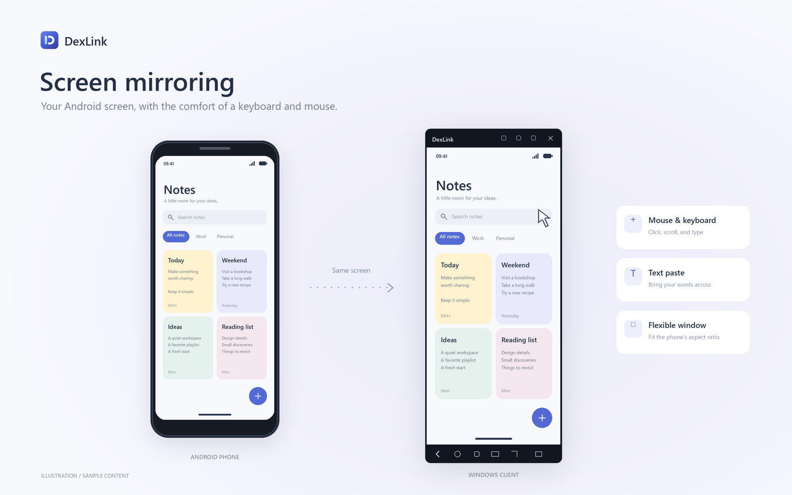
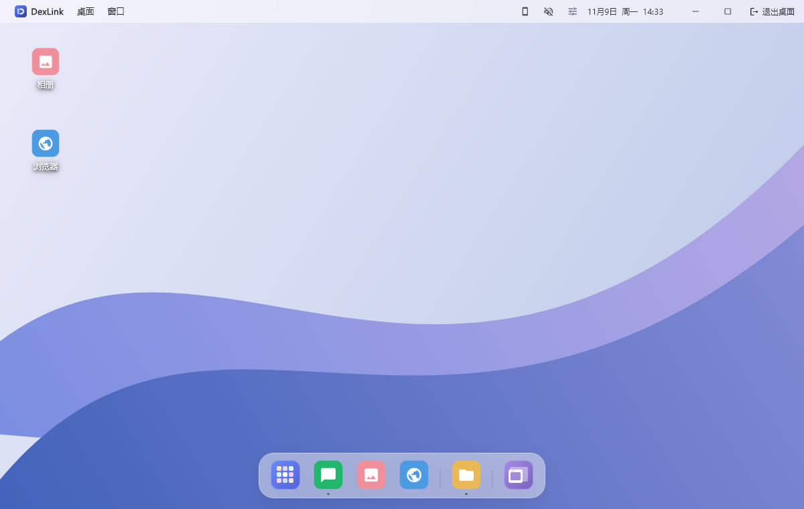
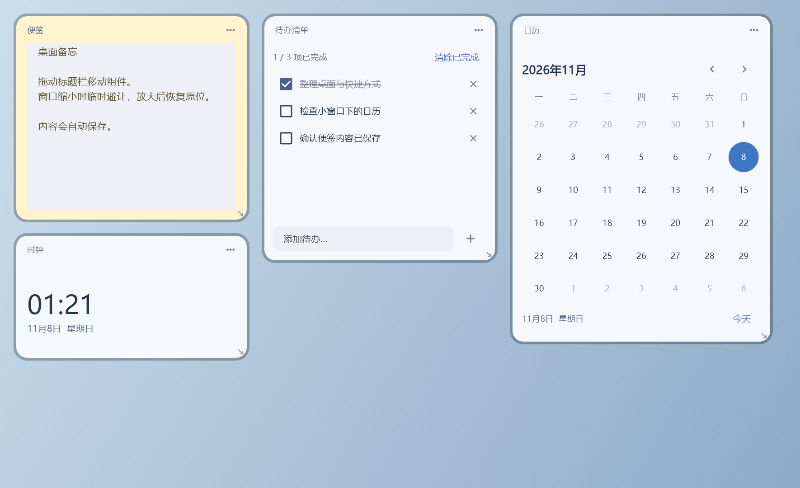

<p align="center">
  
</p>

# DexLink

**把 Android 手机投屏到 Windows，用键鼠操作；也能进入独立桌面，把手机应用放进桌面工作区。**

**简体中文** · [English](README.en.md)

[](https://github.com/Fleve-MY/DexLink/releases)
[](LICENSE)
[](https://github.com/Fleve-MY/DexLink/actions/workflows/ci.yml)

DexLink 提供**屏幕投屏**和**独立桌面**两种使用方式，由 Android 手机端和 Windows 客户端配合，通过局域网或 USB 网络共享连接。手机运行应用，电脑显示画面并接收键鼠操作。

当前版本为 **0.1.0 预览版**。主要真机验证环境为小米 15 Pro / Android 17，其他系统与机型的适配情况欢迎通过 Issue 反馈。

## 两种模式

| | 屏幕投屏 | 独立桌面 |
| --- | --- | --- |
| 显示内容 | 手机当前屏幕，同步显示手机上的操作 | 手机应用运行在独立副屏，在电脑工作区中管理应用窗口 |
| 使用场景 | 在电脑上操作手机、展示手机画面、输入文字 | 多应用窗口协作、应用切换与桌面整理 |
| 操作方式 | 鼠标点击、滚轮、键盘输入和手机导航 | 窗口移动、缩放、最小化与恢复，配合 Dock 和应用搜索 |
| 手机授权 | 普通投屏使用系统录屏授权，键鼠控制需开启无障碍；增强投屏使用 Shizuku 授权 | 需启动 Shizuku 兼容管理器并授权 DexLink |

### 屏幕投屏

把手机当前画面同步到电脑窗口，按手机画面比例显示，支持窗口缩放、返回、主屏幕、最近任务和剪贴板文字粘贴。适合直接使用手机现有应用，或在电脑上展示手机操作。



*投屏效果示意图，按现有窗口布局绘制，使用示例笔记内容。*

### 独立桌面

在电脑工作区打开手机应用，通过应用搜索、快捷方式和 Dock 切换应用，并管理应用窗口的位置与大小。



<details>
<summary>查看便签、待办、时钟和日历组件</summary>



</details>

*桌面与组件界面预览使用示例数据。*

## 下载与开始使用

前往 [Releases](https://github.com/Fleve-MY/DexLink/releases) 下载：

- **Windows x64**：`DexLink-win64.zip`。完整解压后运行 `DexLink-win64/dex_pc.exe`，保留同目录的 DLL、`data` 和 `support`。
- **Android**：`DexLink-phone.apk`，要求 Android 8.0 或更新版本。
- **校验文件**：`SHA256SUMS.txt`，用于核对下载文件。

1. 安装 Android 手机端，解压 Windows 客户端。
2. 让手机与电脑连接到同一可信局域网，或开启手机的 USB 网络共享。
3. 在手机端选择“屏幕镜像”或“独立桌面”，完成对应授权后点击“开始投屏”或“启动独立桌面”。
4. 打开 Windows 客户端，选择自动发现的手机并连接。

**普通投屏**：同意系统录屏提示，按引导开启无障碍以使用键鼠控制。**增强投屏或独立桌面**：先启动 Shizuku 兼容管理器，并在手机上授权 DexLink。

电脑连接页也提供 **USB 安装手机应用**：开启手机 USB 调试并允许当前电脑后，选择设备安装内置 APK。Android 17 的当前内置方案为 Shizuku + Nightzuku。安装后仍需在手机启动管理器并授权。

## 功能

| 功能 | 说明 |
| --- | --- |
| 屏幕投屏 | 同步手机当前屏幕，支持鼠标、滚轮、文字输入和手机导航 |
| 增强控制 | 通过 shell 权限实时注入鼠标和键盘事件 |
| 独立桌面 | 应用搜索、Dock、快捷方式、任务切换，以及应用窗口的移动、缩放、最小化与恢复 |
| 原生视频 | Media Foundation / D3D11 解码与 Flutter 纹理呈现，提供软件解码和兼容回退 |
| 文件传输 | 浏览共享目录，上传与下载文件 |
| 文字和附件输入 | 从电脑粘贴文字；可选输入辅助支持向兼容编辑器提交图片和文件 |
| 手机音频 | 增强会话支持系统音频回传与静音 |
| 本地小组件 | 时钟、日历、便签与待办，数据保存在电脑 |

桌面中的应用内容来自手机实时视频，每个受管理应用使用独立副屏。应用窗口位于 DexLink 主窗口内。

## 使用边界

- **连接安全**：当前面向可信局域网。局域网桥接入口尚待完善设备配对与统一授权，视频传输未加密。请保持端口在可信网络内，避免公网映射。
- **无线稳定性**：部分 Wi-Fi 场景仍出现秒级停顿，受网络环境与恢复过程影响。
- **系统兼容**：增强模式依赖 shell 权限、ROM 和应用的副屏适配。受保护内容受 Android 采集限制。
- **附件输入**：需在手机选择可选的 DexLink 输入辅助，目标编辑器需支持对应附件类型。分享和发送由用户在目标应用完成。
- **音频**：普通录屏模式暂未提供音频回传，精确音画同步仍待完善。
- **预览签名**：当前 Android 包使用开发签名。后续正式签名变化时，安装更新可能需要重新安装应用。

## 从源码构建

开发环境：Flutter **3.47.5** / Dart **3.13.4**、JDK 17、Android SDK。Windows 构建还需要 Visual Studio 2022 的 C++ 桌面开发工具和 Windows SDK。

先在仓库根目录执行：

```powershell
flutter pub get --directory app_phone
flutter pub get --directory app_pc
dart pub get --directory packages/dex_link
```

构建 Android：

```powershell
cd app_phone
flutter build apk --release --no-tree-shake-icons
cd ..
```

构建 Windows 前，准备离线 USB 安装资源。下载 [Shizuku 13.6.0](https://github.com/RikkaApps/Shizuku/releases/tag/v13.6.0) 和 [Nightzuku 13.7.1-r60](https://github.com/kerneldroid/Nightzuku/releases/tag/v13.7.1-r60) 的正式 APK，然后执行：

```powershell
python tools/prepare_usb_bundle.py --sdk "C:/path/to/Android/Sdk" --shizuku "C:/downloads/shizuku.apk" --nightzuku "C:/downloads/nightzuku.apk"
cd app_pc
flutter build windows --release --no-tree-shake-icons
cd ..
```

准备脚本检查包名、签名与包体，生成 `app_pc/bundled`。APK、ADB 和构建输出保留在本地，发布到 GitHub Release。

输出路径：

- 手机：`app_phone/build/app/outputs/flutter-apk/app-release.apk`
- 电脑：`app_pc/build/windows/x64/runner/Release/`，分发时需要完整目录

如需生成带许可证和校验文件的发布包：

```powershell
python tools/package_release.py
```

## 反馈与许可

通过 [Issues](https://github.com/Fleve-MY/DexLink/issues) 反馈问题或提出功能建议，附上软件版本、系统版本、手机型号、连接方式和复现步骤。日志分享前请删除个人内容与设备信息。

安全问题请使用 [私密漏洞报告](https://github.com/Fleve-MY/DexLink/security/advisories/new)。

DexLink 源码使用 [Apache License 2.0](LICENSE)，第三方组件沿用各自协议，见 [第三方声明](THIRD_PARTY_NOTICES.md)。

<br><br><br>

<a href="https://www.star-history.com/?repos=Fleve-MY%2FDexLink&amp;type=date&amp;legend=top-left">
  <picture>
    <source media="(prefers-color-scheme: dark)" srcset="https://api.star-history.com/chart?repos=Fleve-MY/DexLink&amp;type=date&amp;theme=dark&amp;legend=top-left" />
    <source media="(prefers-color-scheme: light)" srcset="https://api.star-history.com/chart?repos=Fleve-MY/DexLink&amp;type=date&amp;legend=top-left" />
    
  </picture>
</a>
